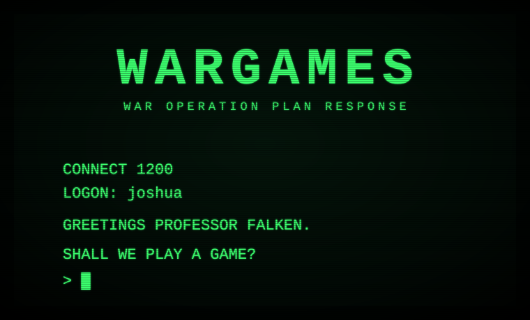
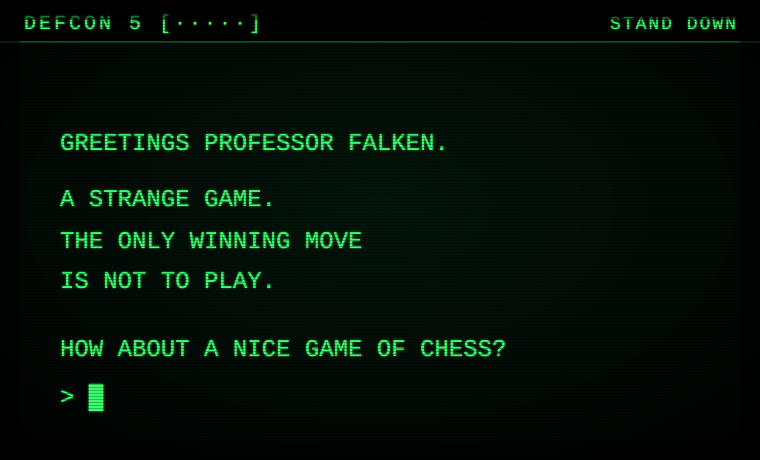

# WarGames: Shall We Play A Game?

An interactive recreation of the 1983 film *WarGames*, played entirely in a retro green-phosphor CRT terminal in your browser. You are David Lightman: a bored teenager with a modem who dials into the wrong computer and nearly starts World War III. The only way out is to teach the machine the lesson it was never given.

**▶ Play: https://azjester.github.io/WarGames-/**

<p align="center">
  
  
</p>

## Run it yourself

No build, no install, no dependencies. Open `index.html` in any modern browser, or serve the folder:

```sh
git clone https://github.com/AzJester/WarGames-.git
cd WarGames-
python3 -m http.server 8000
# then visit http://localhost:8000
```

## Never seen the movie?

You don't need to. Type `STORY` at any prompt for a one-minute, spoiler-free briefing. The short version: it's 1983, the US and the Soviet Union hold each other at nuclear gunpoint, and computers talk over phone lines. You're a teenager hunting an unreleased video game, and the unlabeled computer you find instead doesn't entirely grasp the difference between games and reality. The amber italic lines throughout are your own thoughts — when you're stuck, they point the way. `HELP` at any prompt tells you what to do right there.

## How it plays

1. **War dialing.** `SCAN` the Sunnyvale exchange. Most numbers are banks, an airline, a dentist's machine; Protovision's line is dead. One answers with a carrier and no name. Dial it.
2. **The backdoor.** The system is locked, and its games have odd names (FALKEN'S MAZE). `RESEARCH FALKEN`, follow the trail to his son, and log on as `JOSHUA`.
3. **The games.** Seven are playable: tic-tac-toe, chess (no castling or en passant; check is called and checkmate ends it), checkers, black jack, five-card-draw poker, Falken's Maze, and Global Thermonuclear War. The board games are live boards: click a square, or type the move. In the war you pick first-strike targets straight off a map of the other side, then watch the big board.
4. **The crisis.** Play the war to the end and the machine doesn't stop. How you handle the NORAD interrogation sets how much they trust you; that trust is the time you get at DEFCON 1 while WOPR brute-forces the launch code character by character on the status bar. Escape the infirmary (the door code is hiding in something you already know), find Falken, and teach Joshua the only lesson he's missing.

Three endings, including a quiet one for the player who refuses to launch and can say why. Each ending closes on a card showing which you found and a hint toward the ones you haven't. Close the tab mid-crisis and you pick up at the same scene next time. Finish the story once and `MENU` at the title jumps anywhere. Impatient? `SKIP` the first two acts at the start; the logon hints still guide you in.

## Controls

Everything can be typed. Most things can also be clicked or tapped.

- **Typing.** Type and press Enter. Up/Down recall earlier input, Escape clears the line. Letters typed while text is still printing are kept and appear at the next prompt.
- **Buttons.** The row under the screen offers the answers that make sense at the current prompt (games, cities, YES/NO, the next clue). Numbered choices are clickable lines. `BUTTONS OFF` hides the row for a pure terminal.
- **Skipping.** Enter, Space, Escape, or a click or tap fast-forwards the text up to the next prompt or animation. A second one skips the animation. Dragging to scroll never skips anything.
- **Scrolling back.** Mouse wheel, touch drag, or PageUp/PageDown. The view stays where you put it while new text prints; a `NEW OUTPUT` button jumps back down.
- **Toolbar** (top right): `SOUND`, `VOICE`, `FAST`, and `HELP`, which opens a panel with every setting and command. The typed forms work at any prompt, including the middle of a game, and never cost a turn:
  - `SOUND OFF` / `SOUND ON`, `VOICE OFF` (silences Joshua), `FAST` / `SLOW`, `CAPTIONS ON` (labels for non-speech sounds)
  - `MODE MODERN` (default) renders the big board on canvas with **real coastlines** (Natural Earth data), true city and missile-field coordinates, and **great-circle trajectories** that cross the Arctic. `VIEW POLAR` switches to the NORAD-wall over-the-pole projection; `VIEW FLAT` is the default world map. `MODE CLASSIC` keeps the ASCII board (rasterized from the same geography).
  - `DIFFICULTY EASY|NORMAL|HARD` tunes the game AIs and the ABM screens (on easy, interceptors thin the retaliation aimed at you; on hard, yours).
  - `HELP` (what to do at this prompt), `OPTIONS` (the panel), `STORY`, `STATS`, `SHARE` (a keepsake card after an ending), `LISTEN ON` (speak to Joshua; Chrome).
- **Games.** Chess and checkers: click a piece, then a square, or type `E2 E4`. Tic-tac-toe: click a square or type 1-9. The maze: arrow keys, the N/S/E/W buttons, or typed directions. Poker: click the cards to throw away, then `DRAW`. Global Thermonuclear War: click cities on the targeting map (again to remove), then `LAUNCH`; side select includes `3. TWO PLAYERS` for hotseat mutual destruction.
- `RESET` at the `LOGON:` prompt wipes saved progress. The game installs as an app and works offline (PWA); when online it always loads the current build. A browser still holding the first offline release is moved to the current build on its next visit, with one automatic reload.

Stuck? The system's designer had a son. Or type `HELP`.

## Accessibility

- All animation (flicker, scanlines, the cursor, the power-on effect, the bad-ending flash) is reduced or disabled under `prefers-reduced-motion`.
- Sound is opt-out and persists. Browsers keep audio muted until your first interaction, so the game opens on a title card; the keypress or tap that powers it on unlocks audio and plays the CRT power-up hum.
- Joshua speaks his lines aloud, in the conversation and in the games, through the browser's speech synthesis. He stops when you answer or skip, and `VOICE OFF` silences him without muting the effects. Lines are rewritten for the engine before they are spoken (the 6/23/73 date, "Dr.", board squares). Whether a voice is available, and what it sounds like, depends on the browser and operating system.
- The game is fully playable from the keyboard; output is mirrored to an `aria-live` log region for screen readers. The toolbar, the suggested-command buttons and the options panel are real buttons with labels and pressed states.
- The DEFCON 1 clock counts down on screen, but the outcome is decided by turns, not seconds: reading slowly, asking for help, or changing a setting never costs anything.
- Text sits in a centered column of at most 90 characters and scales with the window. On touch devices the keyboard only opens when you tap the input bar.

## Development

Plain HTML/CSS/JS, classic scripts, no toolchain. The dialogue, game, intro, crisis, settings, and sound logic are DOM-free and covered by node tests (also run in CI). Layout, input handling, the canvas boards, and the story flow are covered by the browser test:

```sh
node tests/smoke.js    # Joshua dialogue engine
node tests/games.js    # tic-tac-toe minimax, GTW map and targeting
node tests/games2.js   # chess, checkers, cards, maze, crisis additions
node tests/intro.js    # war-dialer and research archive
node tests/crisis.js   # DEFCON 1 decision logic and endings
node tests/sound.js    # sound module, and Joshua's voice against a fake speech engine
node tests/modern.js   # modern-mode core (arcs, targeting map, fallback)
node tests/ui.js       # settings registry behind the toolbar and commands
node tests/browser.js  # real-browser playthroughs, laptop and phone (CI; needs playwright)
```

### Layout

```
index.html            the monitor: top bar, screen, suggested commands, input
css/crt.css           phosphor theme, centered layout, live boards, DEFCON bar
js/terminal.js        typewriter output, input, skip and type-ahead rules,
                      scroll-back, chips, live boards, status bar
js/ui.js              settings registry, toolbar, HELP / OPTIONS panel
js/sound.js           synthesized modem / klaxon / key clicks (WebAudio),
                      and Joshua's voice (speech synthesis)
js/parser.js          shared parsing (game aliases, yes/no)
js/geo.js             baked Natural Earth coastlines + land raster
js/modern.js          canvas big board, targeting map, montage, share card
js/intro.js           Acts 1-2: war-dial pool + research archive
js/wopr.js            Joshua's dialogue engine
js/games/             the seven playable games (pure cores + play loops)
js/crisis.js          Acts 4-5: climax intent, clock, endings
js/engine.js          save/load, checkpoints, and the scene runner
js/main.js            scene wiring, global commands, title and end cards
sw.js                 offline support (network first, cache fallback)
```

## Deployment

The site is static; `.github/workflows/pages.yml` publishes the repo root to GitHub Pages on every push to `main`. One-time setup: repo **Settings → Pages → Source: GitHub Actions**. The play link above goes live once that's enabled and this branch is merged.

## Credits

A tribute to *WarGames* (1983), directed by John Badham. Dialogue is adapted, not transcribed. The point stands: the only winning move is not to play.

The text is set in **Glass TTY VT220** by Viacheslav Slavinsky (svofski), the rounded terminal face that matches the film's WOPR displays, vendored in `assets/fonts/`. Box-drawing, block, shade, and marker glyphs were synthesized into it at its own fixed width so the tic-tac-toe and big-board grids stay aligned. A vector build of the **IBM VGA 8x16** CP437 bitmap (bitmap by farsil, CC BY-SA 4.0) ships as a same-width fallback. See `assets/fonts/`.
